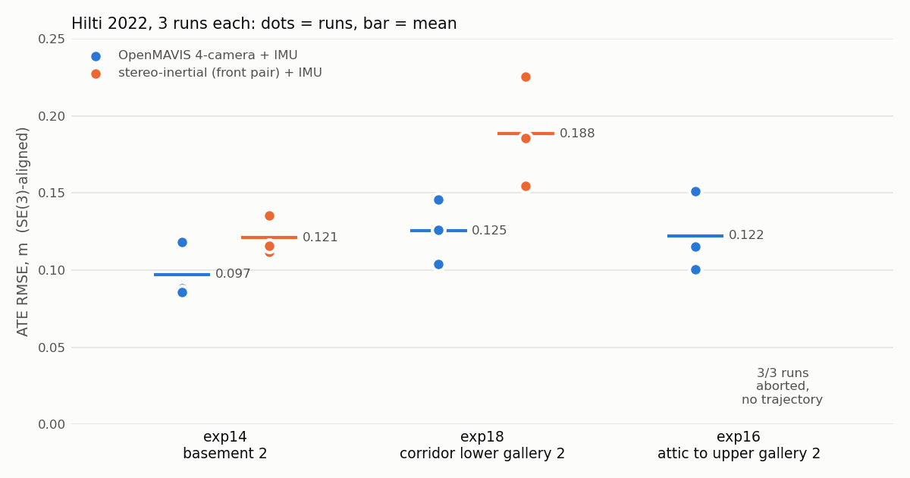
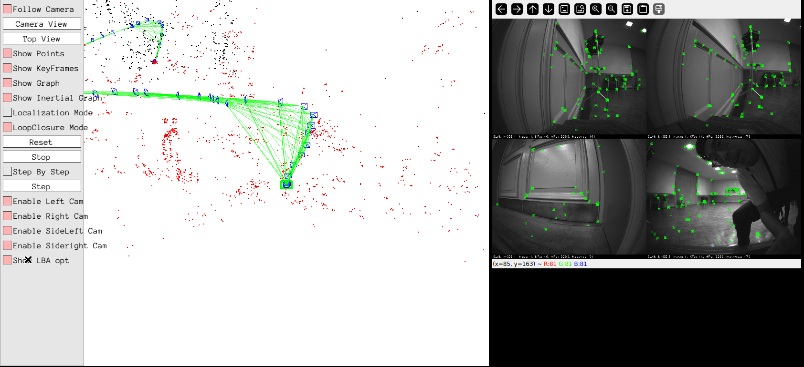

# OpenMAVIS_docker

Upstream [OpenMAVIS](https://github.com/MAVIS-SLAM/OpenMAVIS) (multi-camera
visual-inertial SLAM on ORB-SLAM3), built **unmodified** in a container on the
latest Ubuntu LTS and evaluated on the Hilti 2022 dataset. Nothing in the
upstream tree is edited; every adaptation is a build flag, an environment
variable or a dataset step in this folder.

## At a glance (2026-10-18)



| Hilti 2022 sequence | bag / GT span, GT path | 4-camera + IMU, ATE mean (min–max), m | stereo-inertial, ATE mean (min–max), m |
|---|---|---:|---:|
| exp14 basement 2 | 74 s / 74 s, 37.8 m | **0.097** (0.086–0.118) | 0.121 (0.112–0.135) |
| exp18 corridor lower gallery 2 | 109 s / 87 s, 50.6 m | **0.125** (0.104–0.146) | 0.188 (0.155–0.225) |
| exp16 attic to upper gallery 2 | 200 s / 200 s, 116.9 m | **0.122** (0.100–0.151) | aborted in 3/3 runs, no trajectory |

- 3 runs per cell. ATE: evo, SE(3) Umeyama alignment (no scale), IMU frame,
  against the 6DoF ground truth, `--t_max_diff 0.02`.
- **4-camera** = `multi_inertial_euroc` (cams 1, 0, 4, 3). **Stereo** =
  `stereo_inertial_euroc` on the front pair (cams 1, 0). Both read the same
  upstream `HiltiChallenge2022.yaml`; in stereo mode it uses only Camera1/2,
  `Stereo.T_c1_c2` and `IMU.T_b_c1`, so intrinsics, extrinsics, IMU noise and
  ORB settings are identical.
- On exp14 the stereo trajectory starts 5.9 s later (its map initialises later),
  so its ATE covers 2723 poses against 2957 for 4 cameras. On exp18 both cover
  the same 4374 poses.
- Tracking: the 4-camera system never lost the local map on any run. Stereo
  lost it 60–71 times per run on exp18 and 550–571 times on exp16 before
  aborting (see upstream defect 3).
- Every completed run used a single map. Full per-run table:
  [results/hilti/summary.md](results/hilti/summary.md).
- Wall time is about 1.5× the sequence length for 4 cameras and 1.3× for stereo.
  This includes the software-rendered viewer, so it is **not** a speed
  measurement.

## Environment

| | version |
|---|---|
| OS | Ubuntu 26.04.1 LTS (linux/arm64, Docker on Apple Silicon) |
| GCC / CMake | 15.2.0 / 4.2.3 |
| OpenCV / Eigen / Boost | 4.10.0 / 3.4.0 / 1.90 |
| Pangolin | v0.9.6 (source) |
| OpenMAVIS | `b13b1c2` (2025-02-07, master HEAD), with its bundled DBoW2 / g2o / Sophus |
| rosbags / evo | 0.11.8 / 1.38.0 |

## Use

```bash
./docker/build.sh                                         # image openmavis:26.04
DATASETS_RW=1 ./docker/run.sh python3 tools/rosbag2euroc.py \
    /datasets/Hilti2022/rosbags/<seq>.bag -o /datasets/Hilti2022/euroc --cams 0,1,3,4
./docker/run.sh tools/run_hilti.sh <seq> multi|stereo [tag]   # one run
./tools/bench_hilti.sh "<seq> <seq> ..." 3                    # all runs, resumable
./docker/run.sh python3 tools/summarize_hilti.py              # results/hilti/summary.md
./docker/run.sh python3 tools/plot_hilti.py                   # docs/media/hilti_ate.png
```

### Watching the viewer

`run_hilti.sh` and `bench_hilti.sh` draw the viewer into a hidden Xvfb, so
nothing appears on screen. To watch a run, use `run_gui.sh`:

```bash
./docker/run_gui.sh tools/run_hilti.sh exp14_basement_2 multi gui         # XQuartz window
./docker/run_gui.sh --vnc tools/run_hilti.sh exp14_basement_2 multi gui   # Screen Sharing, password openmavis
```



- The map and the four camera images open side by side in one 1684×770
  window (`GUI_SCREEN` changes the size). The window closes when the run ends,
  as upstream does.
- XQuartz must allow network clients (Settings > Security).
- Use a run tag other than `r1`–`r3`, such as `gui` above, so GUI runs stay
  out of the summary.
- Pangolin 0.9.6's X11 backend learns its window size only from
  `ConfigureNotify`. Without a window manager it lays the map out for a 0×0
  window: no menu, and the map squeezed into a corner.
  `docker/gui_launch.sh` resizes the window once to trigger the event, then
  moves the camera window beside the map.

`../Datasets` is mounted read-only at `/datasets`. The data in
`Datasets/Hilti2022` comes from the
[Hilti 2022 Hugging Face mirror](https://huggingface.co/datasets/Hilti-Research/hilti-slam-challenge-2022):

- `rosbags/` holds the downloaded bags.
- `ground_truth/` holds the `*_imu.txt` 6DoF ground truth.
- `euroc/` holds the **Hilti data converted to the EuRoC/ASL folder layout**
  that the OpenMAVIS examples read. It is not the EuRoC dataset.

## What it took (no upstream edits)

| Problem on the new toolchain | Handled by |
|---|---|
| CMake 4 rejects `cmake_minimum_required(2.8)` | `-DCMAKE_POLICY_VERSION_MINIMUM=3.5` |
| Upstream forces `-std=c++11`; Pangolin 0.9 needs ≥ C++14; `LoopClosing.cc` does `bool++`, which is an error in C++17 | `-std=gnu++14` appended via `CMAKE_CXX_FLAGS_RELEASE` (the later `-std` wins) |
| Sophus tests carry `-Werror` and fail on GCC 15 | not built (Sophus is header-only for OpenMAVIS) |
| Pangolin picks Wayland by default, but the container has X (Xvfb) | `PANGOLIN_WINDOW_URI=x11://` |
| The viewer is hard-wired on in the examples | Xvfb + llvmpipe in `docker/entrypoint.sh` |
| The README's converter needs ROS 1 (`rosbag`, `cv_bridge`) | `tools/rosbag2euroc.py`: same layout, built on pure-Python `rosbags` |

## Upstream defects found

1. **`multi_inertial_euroc` loses the whole run if any frame is missing from a
   camera.** It returns 1 without saving a trajectory on the first image it
   cannot read. Hilti bags can end with one camera a frame short (exp14: cam4;
   exp16: cam0), so the README recipe of taking timestamps from cam0 alone
   fails. The converter therefore keeps only frames present in every exported
   camera.
2. **Stereo-inertial aborts on exp16 in every run** with an OpenCV assertion in
   `batch_distance`, raised from `Frame::ComputeStereoFishEyeMatches`
   (`Frame.cc:1303`). It calls `knnMatch` on the overlap-region descriptors
   with no empty check, so a frame with no features there kills the process.
   The same code is in ORB-SLAM3 v1.0, so this is inherited, not introduced by
   OpenMAVIS.
3. **Crash at teardown.** A segfault (exit 139) can occur after both
   trajectory files are written (1 of 9 four-camera runs, exp16 r3). The
   result is still valid.
4. **Every PinHole example config fails to load.** Commit `985c800` made
   `CameraN.overlappingBegin/End` required for PinHole cameras, but the shipped
   PinHole yamls (EuRoC / TUM / KITTI) do not set them. The same commit
   `static_cast`s a `Pinhole*` to `KannalaBrandt8*`, which is undefined
   behaviour; it only works because both classes put that member at offset 40.
   This does not affect the Hilti (KannalaBrandt8) runs.
